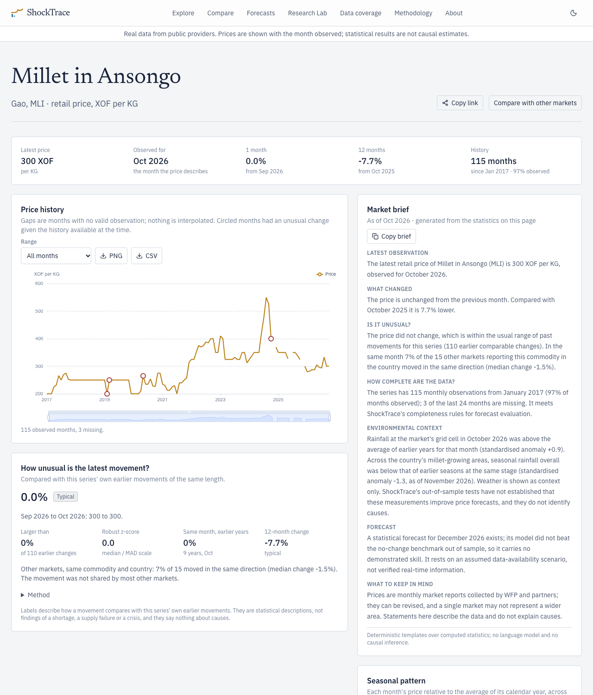

# Market Almanac

**Open-source food-price research platform with honest forecast evaluation.** Market Almanac
collects the monthly market prices the World Food Programme publishes for every country on HDX,
tracks their quality and coverage country by country, places them next to weather and crop data,
and runs pre-registered, reproducible forecasting studies, with every number traceable to its
source.



## What you can do with it

- **See global coverage** (`/atlas`): 95 countries with stored WFP prices (3,801,021 monthly
  observations, 125,202 series, 4,835 markets), each with a status (validated, research-eligible,
  forecast-evaluated…), QC results, snapshot hashes and licence; the 149 areas with no integrated
  price source are shown as gaps, not hidden.
- **Read a multi-country study** (`/forecastability`): the pre-registered Forecastability Atlas
  across 39 countries, with intervals, placebos, robustness checks and per-country tables.
- **Design a study** (`/workbench`): build a versioned specification, validate it on the server,
  then run it reproducibly with the CLI. Published studies are in `/studies`.
- **Explore** (original 10-country market views) 22,880 market–commodity series in 10 countries (959 markets, 502,883 monthly prices,
  January 2017 to November 2026); 11,212 series have at least a year of prices. Filter by country,
  commodity and market, on a map or in an accessible table.
- **Read a market**: latest observed price with its month, unit, currency and price type;
  1- and 12-month changes; how unusual the latest change is against the series' own history and
  the same calendar month; whether other markets moved too; seasonality; rainfall and temperature
  context; data completeness; source snapshot and licence; a deterministic plain-language brief.
- **Compare markets** for the same commodity, unit and price type: price levels when currency
  matches, indexed movements otherwise; invalid comparisons are refused with the reason.
  Selections live in the URL; charts export as PNG and data as CSV.
- **Check forecasts against a benchmark**: every forecast shows its origin, target month, horizon,
  interval, the no-change benchmark and whether the model beat it out of sample.
- **Inspect the research**: a pre-registered study with its protocol, tag, tables, placebo and
  sensitivity checks, and the full lineage of superseded runs.

Screenshots: [home](docs/screenshots/home.png) · [explore](docs/screenshots/explore-mali.png) ·
[compare](docs/screenshots/compare-millet.png) · [research lab](docs/screenshots/research-lab.png) ·
[forecasts](docs/screenshots/forecasts.png) · [data coverage](docs/screenshots/data-coverage.png) ·
[phone](docs/screenshots/mobile-market.png). All are of the running app on real data.

## What the research found

### Forecastability Atlas v1 (39 countries, confirmatory)

Question: *across WFP-reporting countries, do market-local rainfall and temperature anomalies improve
staple-price forecasts beyond price history?* Tagged `protocol-atlas-v1` before any model was
estimated ([protocol](docs/research/FORECASTABILITY_ATLAS_PROTOCOL.md)).

**Result: no improvement established.** Over 113 cereal and tuber groups in 39 countries (about
2,300 series, 55–57 monthly origins from January 2022), the country-balanced loss ratio of weather +
price history over price history was 0.981 at 1 month (95% interval 0.928–1.039, Holm p = 0.50) and
1.005 at 3 months (0.985–1.025, p = 0.80). A placebo using weather from five years earlier did at
least as well as real weather (0.858 at 1 month), and price history alone did not beat a no-change
forecast on this estimand. [Tables](docs/research/generated/forecastability_atlas_v1.md) ·
[results](docs/RESULTS.md). An independent script recomputes the headline numbers to 1.6 × 10⁻¹⁵.

An [independent audit](docs/audits/ATLAS_V1_INDEPENDENT_AUDIT.md) (v1.1) rebuilt the predictions from
the raw snapshots with separate code and confirmed the verdicts. It also qualifies three
statements:

* the 1-month figures and the placebo are dominated by Gaza (PSE) and one penalty choice;
* beating seasonal-naive is not evidence of skill;
* before the audit, the Atlas could not be reproduced from public artefacts. It now can, from the
  [reproducibility package](https://github.com/aneesh-6220/market-almanac/releases/tag/atlas-v1-repro) published on 2026-11-18.

### Sahel production-weather study (Mali and Niger, confirmatory)

Question: *does rainfall in the areas where a crop is grown help forecast staple prices, beyond
price history and weather at the market itself?* The design, data and tests were written down and
tagged (`protocol-sahel-v1`) before any Mali or Niger model was estimated
([protocol](docs/research/RESEARCH_PROTOCOL.md)).

**Result: no established improvement.** In Mali and Niger (282 price series, 64–68 monthly test
origins from 2021), none of the 8 confirmatory comparisons was significant after Holm adjustment,
and all 8 point estimates favoured the model *without* production-region weather (loss ratios
1.08–1.28). Market-local weather did not help either. With about 65 test months, improvements of a
few percent cannot be detected, so this is not evidence that weather does not matter for food
prices. [Full tables](docs/research/generated/sahel_study_confirmatory.md) ·
[results and history](docs/RESULTS.md).

The tables can be checked without trusting the code that produced them:
`scripts/audit/recompute_study.py` re-derives all 18 pooled comparisons from the stored
per-forecast predictions (maximum discrepancy 4 × 10⁻¹⁶).

> Predictive, not causal. Forecast timing rests on stated publication-lag assumptions, because the
> sources do not publish release dates; the backtests are retrospective, not real-time.

## Quick start

Requirements: Python 3.12 with [uv](https://docs.astral.sh/uv/), Node.js 20+.

**Synthetic demo (offline, no credentials):**

```bash
make setup        # uv sync + npm ci
make demo         # migrate a local SQLite database and seed synthetic "Demoland" data
make dev          # API on :8000, web on :3000
```

**Real data from a published data bundle (no provider credentials needed):**

```bash
export MARKET_ALMANAC_MODE=live DATABASE_URL=sqlite:///./data/live.db
uv run market-almanac bundle-install <bundle.tar.gz or https URL> --sha256 <published hash>
uv run market-almanac db-init && uv run market-almanac sync-db
make dev
```

A bundle holds the lake snapshots, the public catalog and the experiment results, with a SHA-256
for every file; `market-almanac bundle-export` builds one from your own ingested data. See
[Reproducibility](docs/REPRODUCIBILITY.md).

**Ingest from the providers yourself** (needs an HDX HAPI app identifier in `.env`):

```bash
export MARKET_ALMANAC_MODE=live
uv run market-almanac doctor --live
uv run market-almanac ingest --source prices --country MLI
uv run market-almanac ingest --source weather --country MLI
uv run market-almanac materialize && uv run market-almanac sync-db
```

**Global ingestion and a study** (see the [maintainer runbook](docs/MAINTAINER_RUNBOOK.md)):

```bash
export MARKET_ALMANAC_MODE=live
uv run market-almanac global discover && uv run market-almanac global ingest   # resumable: --resume <run_id>
uv run market-almanac global weather --spec docs/research/specs/forecastability-atlas-v1.yaml
uv run market-almanac global registry
uv run market-almanac research run docs/research/specs/forecastability-atlas-v1.yaml --workers 6
uv run market-almanac research verify data/studies/live/forecastability-atlas-v1
uv run python scripts/audit/recompute_atlas.py data/studies/live/forecastability-atlas-v1
```

## Architecture

```
providers (HDX HAPI, NASA POWER, World Bank, IMF, FAOSTAT, MapSPAM, crop calendar)
   │  resilient HTTP client: allow-list, retries, Retry-After, credential-free cache keys
   ▼
immutable Parquet snapshots (content-hashed manifests) ──► DuckDB / pandas
   │                                      │
   ▼                                      ▼
research engine (features, ridge /    public analytics (catalog, movement,
logistic models, rolling-origin        comparison, seasonality, briefs)
backtests, DM tests, bootstrap)           │
   │  artefacts: results.json,            │
   │  predictions.parquet, manifest       │
   ▼                                      ▼
PostgreSQL / SQLite index  ◄── sync-db ── FastAPI (read-only /api/v1) ──► Next.js web app
(experiments, lineage, forecasts)
```

- `packages/market-almanac`: providers, data lake, features, models, evaluation, study runner, CLI.
- `apps/api`: FastAPI, read-only, rate-limited, OpenAPI at `/docs`.
- `apps/web`: Next.js 16, TypeScript, Tailwind, ECharts, MapLibre, TanStack Query, Zod.

More in [Architecture](docs/ARCHITECTURE.md) and the
[engineering learning guide](docs/ENGINEERING_LEARNING_GUIDE.md).

## Testing

```bash
make test        # Python tests: unit, API integration, scientific correctness (offline)
make lint        # ruff, mypy, ESLint, tsc
make test-web    # Vitest
make e2e         # Playwright on the synthetic demo (desktop + phone)
make e2e-live    # Playwright on real ingested data (needs the data bundle)
make test-live   # opt-in tests against the real provider APIs
```

## Limitations

- Prices are nominal and in local currency; nothing is converted or deflated. Global coverage is
  what HDX HAPI publishes (95 countries); IMF and FAOSTAT context is still limited to the original
  countries, and CHIRPS, FEWS NET and FAO FPMA are not integrated.
- Studies run on a maintainer machine (the atlas: 5.6 hours on 6 cores, 1.5 GB peak); the public site
  validates specifications but never executes them.
- Publication dates are not available from the sources, so "what was known when" is an assumption
  (primary: prices available one month after the month they describe).
- Production-region weather is a national crop-area proxy (MapSPAM 2010), not the supply origin of a
  particular market.
- Live at https://market-almanac-app.vercel.app/ (API https://market-almanac.onrender.com/, Render
  Free: the first request after idling can take about a minute). See [Deployment](docs/DEPLOYMENT.md).

Full list: [Research limitations](docs/RESEARCH_LIMITATIONS.md).

## Documentation

[Architecture](docs/ARCHITECTURE.md) · [Data sources](docs/DATA_SOURCES.md) ·
[Data dictionary](docs/DATA_DICTIONARY.md) · [Methodology](docs/METHODOLOGY.md) ·
[Results](docs/RESULTS.md) · [Reproducibility](docs/REPRODUCIBILITY.md) · [API](docs/API.md) ·
[Deployment](docs/DEPLOYMENT.md) · [Development](docs/DEVELOPMENT.md) ·
[Engineering report](docs/FINAL_ENGINEERING_REPORT.md) · [Changelog](CHANGELOG.md)

Global platform: [Status ledger](docs/GLOBAL_EXPANSION_STATUS.md) ·
[Systems walkthrough](docs/SYSTEMS_WALKTHROUGH.md) ·
[Research design explained](docs/RESEARCH_DESIGN_EXPLAINED.md) · [ADRs](docs/adr/README.md) ·
[Maintainer runbook](docs/MAINTAINER_RUNBOOK.md) · [Exercises](exercises/README.md) ·
[Citation](CITATION.cff)

## Licence and data

Code: [MIT](LICENSE). Data remain under their providers' terms (summarised in
[docs/DATA_SOURCES.md](docs/DATA_SOURCES.md)): cite WFP/HDX, NASA POWER, the World Bank, the IMF,
FAO and IFPRI MapSPAM when you reuse results.
