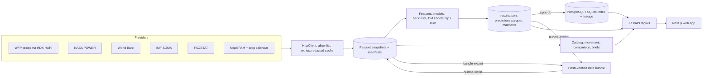

# Portfolio release kit

Factual material for GitHub, LinkedIn, a résumé and demos. Every claim below is backed by the
repository (tests, stored artefacts or documents) as of v1.0.0 (2026-11-17). Things that do not exist
yet (a public URL, a published repository, users) are not claimed. Fill in links only once they are real.

## Title

**Market Almanac: food-price intelligence and pre-registered forecast evaluation**

## GitHub description (≤ 350 characters)

> Open-source food-price intelligence on WFP market data for 10 countries: market histories,
> unusual-movement analysis, valid cross-market comparison and forecasts scored against simple
> benchmarks. Includes a pre-registered study of crop-region weather and price forecasting (result:
> no established improvement). Python, FastAPI, Next.js.

Topics: `food-security`, `econometrics`, `forecasting`, `time-series`, `fastapi`, `nextjs`,
`open-data`, `reproducible-research`, `pre-registration`.

## README presentation

The README already covers what the project does, what users can do, the data, the architecture,
the research result, real screenshots, installation, reproducibility and limitations. When the
repository is public, add: the repository URL, the data-bundle release URL and SHA-256, and a live
demo URL only once a deployment is running and checked.

## Verified facts you can cite

| Fact | Source of evidence |
|---|---|
| 10 countries, 959 markets, 22,880 series (11,212 with ≥ 12 monthly prices), 502,883 monthly prices, Jan 2017 – Nov 2026 | `data/public/live/coverage.json`, `/api/v1/catalog/coverage` |
| 5 live data providers plus MapSPAM crop geography and a crop calendar | `packages/market-almanac/src/market_almanac/providers/`, `geo/` |
| Pre-registered study, 8 confirmatory tests, Holm-adjusted, 0 significant, all 8 ratios > 1 | `docs/research/generated/sahel_study_confirmatory.md`, tag `protocol-sahel-v1` |
| Study tables recomputed independently to 4.4 × 10⁻¹⁶ | `scripts/audit/recompute_study.py` |
| A data defect (one 276.5 mm rainfall day giving z = 217) found and fixed; it had moved a loss ratio from 0.98 to 1.42 | `docs/audits/SCIENTIFIC_VALIDITY_AUDIT.md` |
| 172 Python tests, 20 component tests, 15 browser tests (demo + live data) | `make test`, `make test-web`, `make e2e`, `make e2e-live` |
| API under 32 concurrent clients: p95 from 21 s to 0.68 s after a vectorisation fix | `docs/FINAL_ENGINEERING_REPORT.md` §9 |
| Hash-verified data bundle; clean-clone install verified | `docs/REPRODUCIBILITY.md` |

## Résumé bullets

**Software engineering**

- Built Market Almanac, an open-source food-price analytics platform (Python/FastAPI, Next.js/TypeScript)
  serving 22,880 market price series from 10 countries through a read-only, rate-limited API with
  strict input validation and schema-checked frontend contracts.
- Diagnosed a CPU-bound hot path under concurrency (per-series slicing of a 500k-row table) and
  replaced it with a vectorised, cached computation: p95 latency at 32 concurrent clients fell from
  21 s to 0.68 s with byte-identical results, guarded by a regression test.
- Designed a hash-verified data distribution format (per-file SHA-256, path-traversal and overwrite
  protection) that lets a fresh clone or container serve the full application without provider
  credentials; verified end to end from a clean checkout.

**Quantitative research**

- Designed and pre-registered (git-tagged) an out-of-sample study testing whether crop-area-weighted
  rainfall improves staple-price forecasts in Mali and Niger; 8 confirmatory Diebold–Mariano tests
  with Newey–West variance, HLN correction and Holm adjustment found no improvement, reported in
  full with placebo and timing sensitivity checks.
- Built leakage-safe rolling-origin backtests with explicit publication-lag scenarios, expanding
  climatologies and purged inner validation; each guard has a dedicated test.
- Found and corrected a data defect in which one implausible rainfall value (z = 217) moved a
  headline loss ratio from 0.98 to 1.42; added climatology-based QC, bounded anomalies and an
  influence diagnostic, and independently recomputed all published study tables.

**Full-stack / data engineering**

- Integrated five public data APIs (WFP via HDX HAPI, NASA POWER, World Bank, IMF SDMX, FAOSTAT)
  plus MapSPAM crop rasters into an immutable, content-hashed Parquet lake with DuckDB queries and a
  rebuildable PostgreSQL index.
- Implemented experiment lineage (Alembic migration, idempotent re-indexing, supersession with
  reasons) and rehearsed the production upgrade on an isolated PostgreSQL copy before applying it.
- Delivered a Next.js market-intelligence interface (map plus accessible table, comparison workbench
  with validity rules, shareable URLs, CSV/PNG export, light and dark themes, phone layouts) covered
  by Playwright tests on both synthetic and real data.

## LinkedIn

**Project description**

Market Almanac is an open-source tool for looking at food prices in markets monitored by the World Food
Programme. It shows what a price did, how unusual a change is for that market, whether other markets
moved too, and what simple forecasting models can and cannot do, with every number traced to its
source. It also contains a pre-registered study asking whether rainfall in crop-growing areas helps
forecast staple prices in Mali and Niger. It did not, and the project reports that in full.

**Technologies:** Python 3.12, pandas, NumPy, scikit-learn, statsmodels, SciPy, DuckDB, Parquet,
SQLAlchemy, Alembic, PostgreSQL, FastAPI, Pydantic, Typer, Next.js 16, React 19, TypeScript, Tailwind
CSS, Apache ECharts, MapLibre, TanStack Query, Zod, Playwright, Vitest, pytest, GitHub Actions.

**Key technical contributions:** leakage-safe backtesting with publication-lag scenarios;
Diebold–Mariano inference with HAC variance, block bootstrap and Holm correction; crop-area weighting
of gridded weather; immutable data lake with experiment lineage; hash-verified data bundles;
public analytics API and web interface.

**Research finding:** in 8 pre-registered tests, crop-region rainfall did not improve 1- or 3-month
price forecasts in Mali or Niger (all loss ratios 1.08–1.28, none significant). With about 65 test
months, small gains could not have been detected, so this is not evidence that weather is
irrelevant to prices.

**Launch post (draft; post only after the repository is public):**

> I've released Market Almanac v1.0, an open-source tool for exploring WFP food-price data across 10
> countries: market histories, how unusual a price change is, valid comparisons between markets,
> and forecasts that are always shown next to a no-change benchmark.
>
> It also includes a study I pre-registered before running it: does rainfall in the areas where
> millet, sorghum, maize and cowpeas are grown help forecast their prices in Mali and Niger? The
> answer, across 8 confirmatory tests, was no. Every comparison favoured the simpler model, and none
> was significant. Along the way I found that one implausible rainfall reading had been enough to
> change an earlier headline result, which is now fixed and documented.
>
> Code, protocol, results and a guide to the methods: [repository link]

**Media:** `docs/screenshots/market-millet-ansongo.png` (lead image), `compare-millet.png`,
`research-lab.png`, `mobile-market.png`; a 60-second screen recording following the walkthrough below.

## Demo scripts

**60-second product walkthrough**

1. Home (5 s): the question, coverage numbers, the study outcome in one line.
2. Type "millet" and choose Mali (10 s): map and table, filter by commodity.
3. Open Ansongo (20 s): latest price and the month it describes; 12-month change; "how unusual"
   panel; the brief; provenance (snapshot, source record).
4. "Compare with other markets", add Badalabougou (15 s): levels and indexed view, CSV export,
   copy link.
5. Forecasts (10 s): a forecast next to its no-change benchmark and "No better than its baseline".

**Three-minute technical walkthrough**

1. Architecture diagram (below): files as source of truth, database as rebuildable index.
2. `data/store.py` snapshots and hashes → `features/builder.py` → `evaluation/backtest.py`
   leakage guard (`target_period + lag <= c`).
3. `evaluation/inference.py`: monthly-mean DM test, Newey–West, Holm.
4. `apps/api/.../deps.py`: snapshot-keyed caches and the vectorised peer panel (show the before and
   after latency numbers).
5. `data/public_bundle.py` and the container entrypoint: how a fresh server gets verified data.
6. Tests: `tests/scientific/`, the two Playwright suites.

**Research methodology walkthrough (5 minutes)**

1. The question and why it is predictive, not causal.
2. Timing: what was known at the forecast origin; lag scenarios L = 0, 1, 2.
3. Features: market-cell weather vs crop-area-weighted weather; crop calendar stages.
4. Design: nested models A / B / P; rolling origin; 64–68 test months.
5. Inference: DM with HAC and HLN; bootstrap CI; Holm over 8 tests; fragility rule.
6. Falsification: time-shifted and wrong-crop placebos.
7. Result and what it does and does not mean; the rainfall defect story; independent recomputation.

## Architecture diagram

## What not to claim

- Not deployed; no users; no live URL (until one exists and is checked).
- No forecasting improvement from weather was found; do not imply one.
- Not real-time: timing rests on publication-lag assumptions.
- Not causal: nothing here identifies why prices moved.
